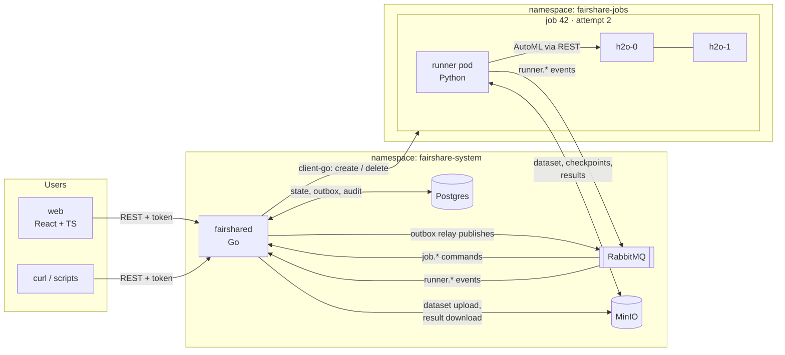

# Fairshare — Architecture

**Status:** Draft v1 (Phase 0)
**Last updated:** 2026-11-14

Related docs: [PRODUCT_SPEC](PRODUCT_SPEC.md) · [JOB_LIFECYCLE](JOB_LIFECYCLE.md) · [SCHEDULING_POLICY](SCHEDULING_POLICY.md) · [DATA_MODEL](DATA_MODEL.md) · [API](API.md)

---

## 1. Overview



**Core rule:** Postgres is the only source of truth for job state. Kubernetes and RabbitMQ are things Fairshare *acts on*. When they disagree with Postgres, Postgres wins and the reconciler fixes the difference.

---

## 2. Components

| Component | Language | Runs as | Responsibility |
|---|---|---|---|
| **fairshared** | Go | Deployment (1–2 replicas) | API, scheduling, all Kubernetes side effects |
| **runner** | Python | One Pod per job attempt | Drives AutoML on its H2O cluster, saves checkpoints, reports events |
| **H2O-3 cluster** | (H2O-3 image, Java) | One StatefulSet per job attempt | Does the training |
| **web** | React + TS | Static files served by nginx | UI for members, admins, auditors |
| **Postgres** | — | StatefulSet | Tenants, users, datasets, jobs, outbox, audit |
| **RabbitMQ** | — | StatefulSet | Durable event delivery |
| **MinIO** | — | StatefulSet | Datasets, checkpoints, results |

---

## 3. Inside fairshared

One Go binary, split into modules with clear boundaries.

| Module | Runs on | Does | Talks to |
|---|---|---|---|
| `api` | every replica | HTTP routes, validation | `auth`, `store`, `audit` |
| `auth` | every replica | Token → user, role checks | `store` |
| `store` | every replica | All SQL. Only module that touches Postgres | Postgres |
| `audit` | every replica | Appends hash-chained audit rows in the caller's transaction | `store` |
| `scheduler` | leader only | Every 2 s: pick jobs to start or preempt. **Writes to Postgres only** | `store` |
| `relay` | leader only | Publishes outbox rows to RabbitMQ | `store`, RabbitMQ |
| `provisioner` | leader only | Consumes `job.*` commands → Kubernetes calls | RabbitMQ, Kubernetes, `store` |
| `events` | leader only | Consumes `runner.*` events → job state changes | RabbitMQ, `store` |
| `reconciler` | leader only | Every 30 s: compares Postgres with Kubernetes, fixes drift | `store`, Kubernetes |
| `leader` | every replica | Holds a Postgres advisory lock. Starts/stops leader-only modules | Postgres |

### Why split "decide" from "do"
- The **scheduler** decides: in one transaction it changes job state and writes an outbox row.
- The **provisioner** does: it reacts to the event and calls Kubernetes, with retries.
- A crash between the two is safe:
  - Decision committed, event not yet sent → the relay sends it after restart.
  - Event sent, Kubernetes call not finished → the message is redelivered, and the call is idempotent.

### Leader election
- Every replica tries to take Postgres advisory lock `fairshare_leader`, held on a dedicated connection.
- Whoever holds it runs the leader-only modules.
- If the connection drops, the lock is released and the leader stops its loops at once.
- The other replica takes the lock within one retry interval (2 s).
- The API runs on every replica, so the API stays up during a leader handover.

---

## 4. Kubernetes layout

### Namespaces
- `fairshare-system`: fairshared, web, Postgres, RabbitMQ, MinIO.
- `fairshare-jobs`: per-job resources only.

### Per job attempt
Each start or resume is a new **attempt** (1, 2, 3…). Resources are named per attempt, so a new attempt never collides with an old one that's still shutting down.

| Resource | Name | Notes |
|---|---|---|
| StatefulSet | `job-<id>-a<n>-h2o` | `replicas` = job slots. 1 CPU + 2 GB per pod |
| Headless Service | `job-<id>-a<n>-h2o` | H2O pods find each other through its DNS |
| Pod | `job-<id>-a<n>-runner` | `restartPolicy: Never`. Grace period 60 s |

- **Labels** on everything: `fairshare.io/job-id`, `fairshare.io/attempt`, `fairshare.io/tenant`.
- **Owner references:** the Service and runner Pod are owned by the StatefulSet. Deleting the StatefulSet cleans up all three.
- **Why a bare Pod, not a Kubernetes Job:** retries are Fairshare's decision, made in Postgres. A Kubernetes Job would retry on its own and break the one-source-of-truth rule.

### H2O cluster formation
- H2O-3 has built-in Kubernetes clustering.
- Each H2O pod gets env vars:
  - `H2O_KUBERNETES_SERVICE_DNS` = the headless Service name
  - `H2O_NODE_EXPECTED_COUNT` = slots
  - `H2O_NODE_LOOKUP_TIMEOUT`
- Pods resolve each other through the headless Service and form one cloud.
- **Validated in Spike A.**

### Safety nets
- **ResourceQuota** on `fairshare-jobs` = cluster capacity. Even a scheduler bug can't overcommit the cluster.
- **RBAC:** fairshared's ServiceAccount can manage StatefulSets, Services and Pods **only** in `fairshare-jobs`.

---

## 5. Messaging (RabbitMQ)

### Topology
- One durable topic exchange: `fairshare.events`.

| Queue | Bound to | Consumer |
|---|---|---|
| `fairshare.provisioner` | `job.provision`, `job.checkpoint`, `job.cancel`, `job.teardown` | `provisioner` |
| `fairshare.runner-events` | `runner.#` | `events` |
| `fairshare.dead-letter` | messages that failed 5 times | none. Shown in admin UI |

### Delivery rules
- **At-least-once.** Duplicates can happen, so every consumer is idempotent.
- Every message has an `event_id` (UUID). Consumers record handled IDs in `processed_events` in the same transaction as their state change. Seen before → acknowledge and skip.
- Consumers also check job state before acting. An event that doesn't fit the current state is acknowledged and logged, not applied.
- The relay uses **publisher confirms**. An outbox row is marked sent only after RabbitMQ confirms it.
- Messages are persistent and queues are durable, so a RabbitMQ restart loses nothing.

### Outbox relay
1. Every 500 ms: select up to 100 unsent outbox rows, oldest first, `FOR UPDATE SKIP LOCKED`.
2. Publish each one and wait for confirms.
3. Set `published_at`.
4. Rows older than 7 days that were sent get deleted.

---

## 6. Runner

One Python process per job attempt. Libraries: `h2o`, `pika` (RabbitMQ), `boto3` (MinIO).

### Normal run
1. Wait for the H2O cluster to report the expected node count.
2. Download the dataset CSV from MinIO and import it into H2O.
3. **If attempt > 1:** load finished models from the job's checkpoint folder in MinIO.
4. Start AutoML with:
   - `max_models` = requested − already finished
   - `max_runtime_secs` = requested − runtime already used
5. A background thread polls the leaderboard every 5 s. For each new model:
   - save the model binary to MinIO
   - send `runner.model_saved`
6. When AutoML ends:
   - build the combined leaderboard (checkpointed + new models)
   - export the best model as a MOJO
   - upload both to MinIO
   - send `runner.finished`

### On SIGTERM (preemption or cancel)
1. Cancel the running AutoML job through the H2O API.
2. Save any finished models not yet saved.
3. Send `runner.checkpointed` with the list of saved models.
4. Exit 0. All of this must fit in the 60 s grace period.

### On error
- Send `runner.failed` with the reason, then exit non-zero.
- If the runner dies without sending anything (OOM, node loss), the reconciler sees the failed Pod.

### Open questions for Spike B
- Can models saved from one H2O cluster be loaded into a new one?
- Can AutoML skip the steps already done? Option: the `modeling_plan` parameter.
- Can a combined leaderboard be built from loaded + new models (`h2o.make_leaderboard`)?

---

## 7. Object storage layout (MinIO)

| Bucket | Path | Written by |
|---|---|---|
| `datasets` | `<tenant_id>/<dataset_id>.csv` | fairshared (upload) |
| `checkpoints` | `<job_id>/models/<model_id>.bin` | runner |
| `checkpoints` | `<job_id>/manifest.json` | runner (finished models + runtime used) |
| `results` | `<job_id>/leaderboard.json` | runner |
| `results` | `<job_id>/best_model.zip` (MOJO) | runner |

- Checkpoints are deleted 7 days after a job reaches a final state.
- Users never access MinIO directly. fairshared streams uploads and downloads after checking permissions.
- **Credentials:** fairshared and runners use separate MinIO users.
  - Runner user: read `datasets`, read/write `checkpoints` and `results`. No delete.
  - Not in v1: per-job credentials scoped to one job's paths.

---

## 8. Reconciler

Runs every 30 s on the leader. For each non-final job, compare the expected and actual Kubernetes state.

| Postgres says | Kubernetes shows | Action |
|---|---|---|
| `PROVISIONING` for > 2 min | no resources | Re-emit `job.provision` |
| `RUNNING` | runner Pod `Failed` or missing | Attempt failed → [JOB_LIFECYCLE](JOB_LIFECYCLE.md) retry rules |
| `RUNNING` | an H2O pod restarted | H2O cloud is broken → delete attempt → attempt failed |
| `CHECKPOINTING` for > 90 s | runner gone, no `checkpointed` event | Use the last manifest in MinIO → `PREEMPTED` |
| final state | resources still exist | Delete them (orphans) |
| *(no job)* | resources with Fairshare labels | Delete them |

- Every action is audited with actor `system:reconciler`.
- Exact transitions live in [JOB_LIFECYCLE](JOB_LIFECYCLE.md).

---

## 9. Security

- **Tokens:** random 32 bytes, shown once, stored as SHA-256.
- **Secrets:** DB, RabbitMQ and MinIO credentials live in Kubernetes Secrets, never in images or Git.
- **Least privilege:**
  - fairshared's Kubernetes rights are limited to `fairshare-jobs` (§4).
  - Runners have no Kubernetes API access (`automountServiceAccountToken: false`).
  - Separate RabbitMQ users: runners may only publish `runner.*`.
- **Containers:** non-root, read-only root filesystem where possible.
- **Not in v1:** NetworkPolicy. kind's default network plugin doesn't enforce it.

---

## 10. Local development

Two modes.

### Dev mode (Phases 1–7)
- Postgres, RabbitMQ and MinIO run in Docker Compose.
- fairshared runs on the host and uses your kubeconfig to reach kind.
- Vite dev server for the UI.

| Service | Port |
|---|---|
| Postgres | 5438 |
| fairshared API | 8030 |
| Vite | 5200 |
| RabbitMQ (AMQP / UI) | 5672 / 15672 |
| MinIO (API / console) | 9000 / 9001 |

- Runner pods inside kind reach host services through `host.docker.internal`.

### In-cluster mode (Phase 8+)
- Everything is installed by the Helm chart into kind.
- This is what CI and the one-command install use.

### Prerequisites to install
- Docker Desktop (running), Go, Helm. kind, kubectl, Python and Java are already present.

---

## 11. Repo layout

```
fairshare/
├── controller/           # Go: fairshared
│   ├── cmd/fairshared/
│   ├── internal/         # api, auth, store, audit, scheduler, relay,
│   │                     # provisioner, events, reconciler, leader
│   └── migrations/       # SQL migrations
├── runner/               # Python runner (+ fake runner mode)
├── web/                  # React + TS (Vite)
├── deploy/
│   ├── compose/          # dev-mode dependencies
│   ├── helm/fairshare/   # Helm chart
│   └── kind/             # kind cluster config
├── spikes/               # Phase 0 experiments (not production code)
├── docs/
└── Makefile
```

---

## 12. Libraries

All are libraries for JD-stack languages.

| Area | Choice |
|---|---|
| Go HTTP router | `chi` |
| Go Postgres driver | `pgx` |
| Go migrations | `golang-migrate` |
| Go Kubernetes | `client-go` |
| Go RabbitMQ | `amqp091-go` |
| Go MinIO | `minio-go` |
| Python H2O | `h2o` |
| Python RabbitMQ | `pika` |
| Python MinIO | `boto3` |
| Web | React, TypeScript, Vite, TanStack Query |
