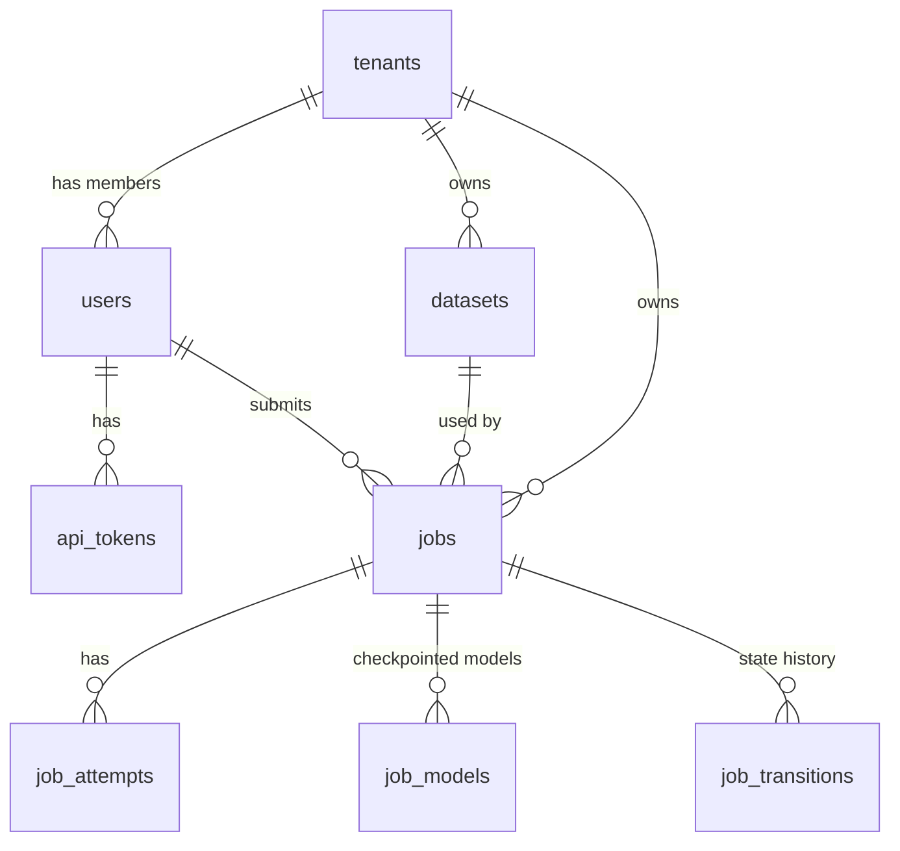

# Fairshare — Data Model

**Status:** Draft v1 (Phase 0)
**Last updated:** 2026-11-14

Related docs: [JOB_LIFECYCLE](JOB_LIFECYCLE.md) · [SCHEDULING_POLICY](SCHEDULING_POLICY.md) · [ARCHITECTURE](ARCHITECTURE.md) · [API](API.md)

Database: PostgreSQL. All timestamps are `timestamptz` in UTC. Migrations live in `controller/migrations/` (golang-migrate).

---

## 1. Overview

Plus standalone tables: `outbox`, `processed_events`, `audit_log`, `allowed_transitions`, `settings`.

---

## 2. Enums

| Type | Values |
|---|---|
| `user_role` | `admin`, `tenant_member`, `auditor` |
| `job_size` | `small`, `medium`, `large` |
| `job_priority` | `low`, `normal`, `urgent` |
| `job_state` | `PENDING`, `PROVISIONING`, `RUNNING`, `CHECKPOINTING`, `PREEMPTED`, `CANCELLING`, `SUCCEEDED`, `FAILED`, `CANCELLED` |
| `attempt_end_reason` | `succeeded`, `preempted`, `cancelled`, `failed_retryable`, `failed_permanent` |

Priority is stored with a numeric rank for sorting: `low` = 0, `normal` = 1, `urgent` = 2.

---

## 3. Tables

### `tenants`
| Column | Type | Notes |
|---|---|---|
| `id` | `uuid` PK | |
| `name` | `text` UNIQUE NOT NULL | e.g. `fraud` |
| `weight` | `int` NOT NULL | `CHECK (weight BETWEEN 1 AND 100)` |
| `max_slots` | `int` NOT NULL | `CHECK (max_slots >= 1)` |
| `created_at` | `timestamptz` NOT NULL | |
| `updated_at` | `timestamptz` NOT NULL | |

### `users`
| Column | Type | Notes |
|---|---|---|
| `id` | `uuid` PK | |
| `name` | `text` UNIQUE NOT NULL | |
| `role` | `user_role` NOT NULL | |
| `tenant_id` | `uuid` FK → tenants NULL | |
| `disabled_at` | `timestamptz` NULL | Disabled users' tokens stop working |
| `created_at` | `timestamptz` NOT NULL | |

- `CHECK ((role = 'tenant_member') = (tenant_id IS NOT NULL))`: members must have a tenant, others must not.

### `api_tokens`
| Column | Type | Notes |
|---|---|---|
| `id` | `uuid` PK | |
| `user_id` | `uuid` FK → users NOT NULL | |
| `token_hash` | `bytea` UNIQUE NOT NULL | SHA-256 of the full token |
| `prefix` | `text` NOT NULL | First 8 chars, e.g. `fs_a1b2c`, for display |
| `label` | `text` NOT NULL | e.g. "laptop" |
| `created_at` | `timestamptz` NOT NULL | |
| `last_used_at` | `timestamptz` NULL | Updated at most once per minute |
| `revoked_at` | `timestamptz` NULL | |

### `datasets`
| Column | Type | Notes |
|---|---|---|
| `id` | `uuid` PK | |
| `tenant_id` | `uuid` FK NOT NULL | |
| `name` | `text` NOT NULL | Original file name |
| `object_key` | `text` NOT NULL | `datasets/<tenant_id>/<id>.csv` |
| `size_bytes` | `bigint` NOT NULL | `CHECK (size_bytes <= 104857600)` (100 MB) |
| `row_count` | `bigint` NOT NULL | |
| `columns` | `jsonb` NOT NULL | `["age", "income", "default"]` |
| `created_by` | `uuid` FK → users NOT NULL | |
| `created_at` | `timestamptz` NOT NULL | |
| `deleted_at` | `timestamptz` NULL | Soft delete (FR-4 checked in code) |

- UNIQUE (`tenant_id`, `name`) WHERE `deleted_at IS NULL`.

### `jobs`
| Column | Type | Notes |
|---|---|---|
| `id` | `bigserial` PK | Short numbers for the UI ("job #42") |
| `tenant_id` | `uuid` FK NOT NULL | |
| `dataset_id` | `uuid` FK NOT NULL | |
| `created_by` | `uuid` FK → users NOT NULL | |
| `idempotency_key` | `text` NULL | From the `Idempotency-Key` header |
| `target_column` | `text` NOT NULL | |
| `size` | `job_size` NOT NULL | |
| `slots` | `int` NOT NULL | Derived from size: 1 / 2 / 4 |
| `priority` | `job_priority` NOT NULL | |
| `max_models` | `int` NOT NULL | `CHECK (max_models BETWEEN 1 AND 50)` |
| `max_runtime_secs` | `int` NOT NULL | `CHECK (... BETWEEN 60 AND 7200)` |
| `seed` | `bigint` NULL | |
| `state` | `job_state` NOT NULL | Default `PENDING` |
| `version` | `int` NOT NULL | +1 on every update (compare-and-set) |
| `current_attempt` | `int` NOT NULL | 0 until first start |
| `wait_reason` | `text` NULL | Code from SCHEDULING_POLICY §7 |
| `wait_detail` | `jsonb` NULL | e.g. `{"slots_needed": 2}` |
| `reserved_at` | `timestamptz` NULL | Set while the job holds the reservation |
| `preemption_count` | `int` NOT NULL | Default 0 |
| `failed_attempts` | `int` NOT NULL | Default 0 |
| `models_completed` | `int` NOT NULL | Default 0 |
| `runtime_used_secs` | `int` NOT NULL | Default 0 |
| `best_model_id` | `text` NULL | |
| `best_metric` | `jsonb` NULL | `{"name": "auc", "value": 0.91}` |
| `leaderboard_key` | `text` NULL | MinIO key, set on success |
| `model_key` | `text` NULL | MinIO key of the best MOJO |
| `error` | `text` NULL | Set on `FAILED` |
| `submitted_at` | `timestamptz` NOT NULL | Never changes (queue order) |
| `first_started_at` | `timestamptz` NULL | |
| `finished_at` | `timestamptz` NULL | Set on any final state |

- UNIQUE (`created_by`, `idempotency_key`) WHERE `idempotency_key IS NOT NULL`.
- At most one reservation: UNIQUE index on `((true))` WHERE `reserved_at IS NOT NULL`.
- At most one urgent job per tenant that isn't finished: UNIQUE (`tenant_id`) WHERE `priority = 'urgent' AND state NOT IN ('SUCCEEDED','FAILED','CANCELLED')`. This enforces FR-8 in the database.
- Indexes:
  - (`state`, `priority`, `submitted_at`): scheduler queue scan
  - (`tenant_id`, `submitted_at` DESC): job lists

### `job_attempts`
| Column | Type | Notes |
|---|---|---|
| `job_id` | `bigint` FK NOT NULL | |
| `attempt` | `int` NOT NULL | 1, 2, 3… |
| `slots` | `int` NOT NULL | |
| `resume` | `bool` NOT NULL | true if it loads checkpoints |
| `created_at` | `timestamptz` NOT NULL | Scheduler decision time |
| `started_at` | `timestamptz` NULL | `runner.started` |
| `ended_at` | `timestamptz` NULL | |
| `end_reason` | `attempt_end_reason` NULL | |
| `released_at` | `timestamptz` NULL | Kubernetes resources confirmed deleted |

- PK (`job_id`, `attempt`).
- **Slots in use** = `SUM(slots) WHERE released_at IS NULL`. Index on (`job_id`) WHERE `released_at IS NULL`.

### `job_models`
Index of checkpointed models. This is what resume reads.

| Column | Type | Notes |
|---|---|---|
| `job_id` | `bigint` FK NOT NULL | |
| `model_id` | `text` NOT NULL | H2O model ID |
| `attempt` | `int` NOT NULL | Attempt that trained it |
| `algo` | `text` NOT NULL | `GBM`, `GLM`, `DRF`, … |
| `metric_name` | `text` NOT NULL | |
| `metric_value` | `double precision` NOT NULL | |
| `object_key` | `text` NOT NULL | |
| `saved_at` | `timestamptz` NOT NULL | |

- PK (`job_id`, `model_id`). Duplicate `model_saved` events become a no-op (`ON CONFLICT DO NOTHING`).

### `job_transitions`
State history for the job timeline in the UI.

| Column | Type | Notes |
|---|---|---|
| `id` | `bigserial` PK | |
| `job_id` | `bigint` FK NOT NULL | |
| `attempt` | `int` NOT NULL | |
| `from_state` | `job_state` NULL | NULL for the initial insert |
| `to_state` | `job_state` NOT NULL | |
| `reason` | `text` NULL | e.g. "preempted for job #51" |
| `actor` | `text` NOT NULL | `user:<id>` or `system:scheduler`, etc. |
| `at` | `timestamptz` NOT NULL | |

- Written by the same trigger that checks transitions (§4), so it can't be skipped.

### `allowed_transitions`
| Column | Type |
|---|---|
| `from_state` | `job_state` |
| `to_state` | `job_state` |

- PK (`from_state`, `to_state`). Seeded by a migration from the table in [JOB_LIFECYCLE §3](JOB_LIFECYCLE.md#3-transitions).

### `outbox`
| Column | Type | Notes |
|---|---|---|
| `id` | `bigserial` PK | Publish order |
| `event_id` | `uuid` UNIQUE NOT NULL | |
| `routing_key` | `text` NOT NULL | e.g. `job.provision` |
| `payload` | `jsonb` NOT NULL | |
| `created_at` | `timestamptz` NOT NULL | |
| `published_at` | `timestamptz` NULL | |

- Index on (`id`) WHERE `published_at IS NULL`.
- Published rows older than 7 days are deleted.

### `processed_events`
| Column | Type | Notes |
|---|---|---|
| `event_id` | `uuid` | |
| `consumer` | `text` | `provisioner` or `events` |
| `processed_at` | `timestamptz` NOT NULL | |

- PK (`event_id`, `consumer`). Rows older than 7 days are deleted (longer than any redelivery window).

### `audit_log`
| Column | Type | Notes |
|---|---|---|
| `id` | `bigserial` PK | Chain order |
| `at` | `timestamptz` NOT NULL | |
| `actor` | `text` NOT NULL | `user:<id>` or `system:<module>` |
| `action` | `text` NOT NULL | e.g. `job.submit`, `tenant.update`, `job.transition` |
| `target_type` | `text` NOT NULL | `job`, `tenant`, `user`, `token`, `dataset`, `setting` |
| `target_id` | `text` NOT NULL | |
| `tenant_id` | `uuid` NULL | For filtering |
| `details` | `jsonb` NOT NULL | Before/after values, reasons |
| `prev_hash` | `bytea` NOT NULL | Hash of the previous row (32 zero bytes for row 1) |
| `hash` | `bytea` NOT NULL | See below |

**Hash:** `SHA-256(prev_hash ‖ canonical_json({id, at, actor, action, target_type, target_id, tenant_id, details}))`
- Canonical JSON: sorted keys, no whitespace, timestamps in RFC 3339 with microseconds.
- **Ordering:** each insert takes `pg_advisory_xact_lock(<audit lock id>)`, reads the last hash, then inserts. This serializes audit writes. That's fine at this scale.
- **Append-only:**
  - a trigger raises an error on `UPDATE` or `DELETE`
  - the app's DB role has only `INSERT` and `SELECT` on this table
- **Verify:** walk rows in `id` order, recompute each hash, return the first mismatch.
- Tamper test (success scenario 4) edits a row as the migration/owner role, bypassing the trigger, then runs verify.

### `settings`
| Column | Type | Notes |
|---|---|---|
| `key` | `text` PK | e.g. `capacity_slots` |
| `value` | `jsonb` NOT NULL | |
| `updated_at` | `timestamptz` NOT NULL | |

- Seeded with the defaults in [SCHEDULING_POLICY §11](SCHEDULING_POLICY.md#11-configuration).

---

## 4. Transition trigger

`BEFORE UPDATE OF state ON jobs`:
1. If `OLD.state = NEW.state`: allow (not a transition).
2. If (`OLD.state`, `NEW.state`) is not in `allowed_transitions`: `RAISE EXCEPTION`.
3. Insert a `job_transitions` row. Actor and reason come from session settings the app sets inside the transaction (`SET LOCAL fairshare.actor = ...`).

`version` is bumped by the app in every `UPDATE jobs` (`SET version = version + 1`), not by the trigger, so progress updates also take part in compare-and-set.

The Go state machine checks the same rules first, so the trigger should never fire in normal use. It's a backstop.

---

## 5. Database roles

| Role | Rights |
|---|---|
| `fairshare_owner` | Owns schema. Used only by migrations |
| `fairshare_app` | `SELECT/INSERT/UPDATE/DELETE` on app tables. **`SELECT/INSERT` only** on `audit_log`. No DDL |

---

## 6. Key queries

| Purpose | Shape |
|---|---|
| Scheduler snapshot | Queued jobs + per-tenant `u_t` + tenants + settings, all in one `REPEATABLE READ` transaction |
| Compare-and-set transition | `UPDATE jobs SET state=$2, ... WHERE id=$1 AND state=$3 AND version=$4` → 0 rows = conflict |
| Relay batch | `SELECT ... FROM outbox WHERE published_at IS NULL ORDER BY id LIMIT 100 FOR UPDATE SKIP LOCKED` |
| Duplicate check | `INSERT INTO processed_events ... ON CONFLICT DO NOTHING` → 0 rows = already handled |

---

## 7. Retention

| Data | Kept |
|---|---|
| Jobs, attempts, transitions, models index | Forever (v1) |
| Outbox (published), processed events | 7 days |
| Checkpoint files in MinIO | 7 days after final state |
| Audit log | Forever. Never deleted |
