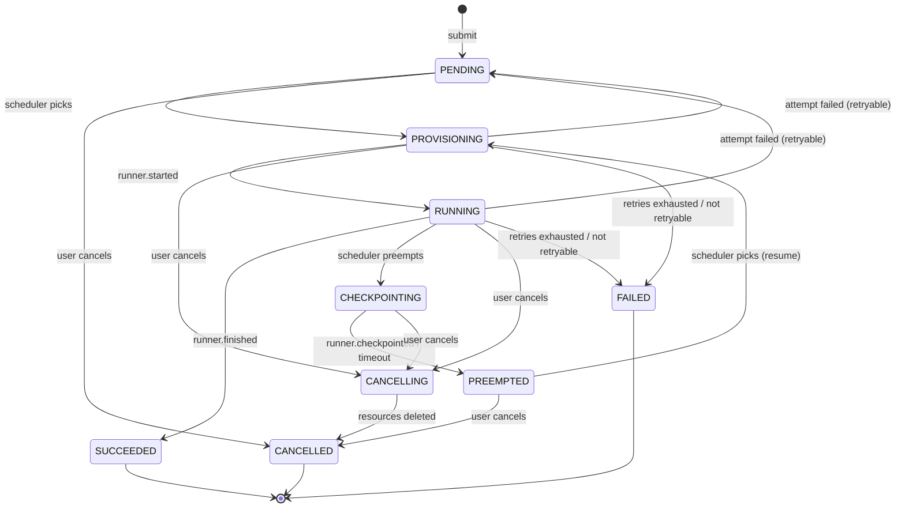

# Fairshare — Job Lifecycle

**Status:** Draft v1 (Phase 0)
**Last updated:** 2026-11-14

Related docs: [PRODUCT_SPEC](PRODUCT_SPEC.md) · [ARCHITECTURE](ARCHITECTURE.md) · [SCHEDULING_POLICY](SCHEDULING_POLICY.md) · [DATA_MODEL](DATA_MODEL.md)

---

## 1. States

| State | Meaning | Holds slots? | Final? |
|---|---|---|---|
| `PENDING` | Waiting in the queue. Never run, or retrying after a failed attempt | No | No |
| `PROVISIONING` | Picked by the scheduler. Kubernetes resources being created | **Yes** | No |
| `RUNNING` | Runner reported `started`. AutoML is training | **Yes** | No |
| `CHECKPOINTING` | Being preempted. Runner is saving finished models | **Yes** | No |
| `PREEMPTED` | Paused by the scheduler. Waiting in the queue to resume | No* | No |
| `CANCELLING` | User cancelled. Runner stopping, resources being deleted | **Yes** | No |
| `SUCCEEDED` | Finished. Leaderboard and best model saved | No* | Yes |
| `FAILED` | Gave up. Reason stored in `jobs.error` | No* | Yes |
| `CANCELLED` | Stopped by a user | No* | Yes |

\* **Slots are released when the attempt's Kubernetes resources are confirmed deleted**, not when the state changes. See §6.

"Queued" means `PENDING` or `PREEMPTED`. The scheduler treats both as waiting.

---

## 2. State diagram

---

## 3. Transitions

Every transition:
- runs in **one Postgres transaction**, together with its outbox row and audit row
- uses a **compare-and-set** update: `WHERE id = $1 AND state = $expected AND version = $v`. If no row is updated, someone else changed the job first, and the caller re-reads and decides again
- is checked twice: by the Go state machine **and** by a database trigger against the `allowed_transitions` table

| # | From → To | Trigger | Actor | Outbox event |
|---|---|---|---|---|
| T1 | `PENDING` → `PROVISIONING` | Scheduler picks job | `scheduler` | `job.provision` (new attempt) |
| T2 | `PREEMPTED` → `PROVISIONING` | Scheduler picks job | `scheduler` | `job.provision` (new attempt, resume) |
| T3 | `PROVISIONING` → `RUNNING` | `runner.started` | `events` | — |
| T4 | `RUNNING` → `SUCCEEDED` | `runner.finished` | `events` | `job.teardown` |
| T5 | `RUNNING` → `CHECKPOINTING` | Scheduler chooses victim | `scheduler` | `job.checkpoint` |
| T6 | `CHECKPOINTING` → `PREEMPTED` | `runner.checkpointed` | `events` | `job.teardown` |
| T6b | `CHECKPOINTING` → `PREEMPTED` | No event within 90 s | `reconciler` | `job.teardown` |
| T7 | `PENDING` / `PREEMPTED` → `CANCELLED` | User cancels | `api` | `job.teardown` (for any leftover resources) |
| T8 | `PROVISIONING` / `RUNNING` / `CHECKPOINTING` → `CANCELLING` | User cancels | `api` | `job.cancel` |
| T9 | `CANCELLING` → `CANCELLED` | Provisioner confirms resources deleted | `provisioner` | — |
| T10 | `PROVISIONING` / `RUNNING` → `PENDING` | Retryable attempt failure, retries left | `events` / `reconciler` / `provisioner` | `job.teardown` |
| T11 | `PROVISIONING` / `RUNNING` → `FAILED` | Retries exhausted, or not retryable | `events` / `reconciler` / `provisioner` | `job.teardown` |

Anything not in this table is rejected.

---

## 4. Attempts

- Every T1/T2 creates a new row in `job_attempts` with the next attempt number.
- Kubernetes resources are named per attempt: `job-<id>-a<n>-…`.
- Every runner event carries `job_id` **and** `attempt`.
- **Stale event rule:** an event whose attempt is not the job's current attempt is acknowledged and ignored. Example: a late `model_saved` from attempt 1 arrives after attempt 2 started.
  - Exception: a stale `runner.model_saved` still records the model in `job_models`, because the file really is in MinIO. Saved work is never thrown away.

### Attempt end reasons
| Reason | Set by |
|---|---|
| `succeeded` | T4 |
| `preempted` | T6 / T6b |
| `cancelled` | T9 |
| `failed_retryable` | T10 |
| `failed_permanent` | T11 |

---

## 5. Failures and retries

### Retryable (attempt fails, job goes back to `PENDING`)
- Runner Pod OOM-killed or evicted.
- An H2O pod restarted (the H2O cloud is broken once a member is lost).
- Pods not ready within the **provisioning timeout** (5 min).
- Kubernetes API errors that persist after the provisioner's own retries.
- Runner lost contact with H2O.

### Not retryable (job goes straight to `FAILED`)
- Dataset missing or unreadable.
- H2O rejects the target column (e.g. constant column).
- AutoML ended with **zero models**.
- Runner reports `runner.failed` with `retryable: false`.

### Limits
- Max **3 failed attempts** per job (`jobs.failed_attempts`). The third failure → `FAILED`.
- Failed attempts and preemptions are counted separately. Preemption is never a failure.
- A retried job keeps its original `submitted_at`, so it doesn't lose its place in line.
- A retried job **still resumes from checkpoints**. Models saved before the failure are reused.

---

## 6. Slot accounting

- A job holds slots from **T1/T2** until its attempt has `released_at` set.
- `released_at` is set by the provisioner **after** it confirms the StatefulSet is gone (not just "delete requested").
- Why not release on state change:
  - Pods can take up to the 60 s grace period to stop.
  - Releasing early would let the scheduler start a new job on capacity that is still in use.
  - The ResourceQuota (see [ARCHITECTURE §4](ARCHITECTURE.md#4-kubernetes-layout)) would then block the new pods, and the job would time out.

---

## 7. Runtime and progress tracking

Fields on `jobs`, updated by runner events:

| Field | Updated on | Used for |
|---|---|---|
| `models_completed` | `runner.model_saved` | UI progress, `max_models` remaining on resume |
| `runtime_used_secs` | `model_saved`, `checkpointed`, `finished` | `max_runtime_secs` remaining on resume |
| `best_model_id`, `best_metric` | `model_saved`, `finished` | UI |

- Runtime counts **only RUNNING time**, summed across attempts. Queue time doesn't count.
- If remaining runtime < 60 s on resume, the job is finished instead of resumed: the combined leaderboard is built from checkpoints and the job → `SUCCEEDED`. (This uses a short "finalize-only" runner attempt.)

---

## 8. Timeouts

| State | Timeout | On timeout |
|---|---|---|
| `PROVISIONING` | 5 min | Retryable failure (T10/T11) |
| `CHECKPOINTING` | 90 s | T6b: use the last manifest in MinIO, go to `PREEMPTED` |
| `CANCELLING` | 90 s | Force-delete resources (grace period 0), then T9 |

All timeouts are checked by the reconciler.

---

## 9. What happens if fairshared crashes

| Crash point | State in Postgres | After restart |
|---|---|---|
| Scheduler decided, before commit | Unchanged | Next tick decides again |
| After T1 commit, before relay sends | `PROVISIONING`, outbox unsent | Relay sends it |
| Event sent, provisioner mid-way through Kubernetes calls | `PROVISIONING` | Message redelivered. Creates are idempotent (`AlreadyExists` = success) |
| Runner sent `started`, consumer crashed before commit | `PROVISIONING` | Message redelivered → T3 |
| Consumer committed T3, crashed before ack | `RUNNING` | Redelivered → `event_id` already in `processed_events` → skip |
| During checkpointing | `CHECKPOINTING` | `runner.checkpointed` waits in RabbitMQ, or T6b timeout |
| During teardown | final state, `released_at` null | `job.teardown` redelivered, or reconciler deletes orphans |

**Invariant:** for every crash point, the job ends in exactly one final state, and at most one attempt is running at any moment.

---

## 10. Events reference

### Commands (fairshared → provisioner)
| Routing key | Payload | Provisioner does |
|---|---|---|
| `job.provision` | `job_id`, `attempt`, `slots`, `resume` | Create StatefulSet, Service, runner Pod |
| `job.checkpoint` | `job_id`, `attempt` | Delete runner Pod (sends SIGTERM) |
| `job.cancel` | `job_id`, `attempt` | Delete runner Pod, then StatefulSet. Then T9 |
| `job.teardown` | `job_id`, `attempt` | Delete StatefulSet. Set `released_at` |

### Runner events (runner → fairshared)
| Routing key | Payload | Effect |
|---|---|---|
| `runner.started` | `job_id`, `attempt`, `h2o_nodes` | T3 |
| `runner.model_saved` | `job_id`, `attempt`, `model_id`, `algo`, `metric`, `object_key`, `runtime_used_secs` | Insert `job_models`, update progress |
| `runner.checkpointed` | `job_id`, `attempt`, `saved_models[]`, `runtime_used_secs` | T6 |
| `runner.finished` | `job_id`, `attempt`, `leaderboard_key`, `model_key`, `best_model_id`, `runtime_used_secs` | T4 |
| `runner.failed` | `job_id`, `attempt`, `reason`, `retryable` | T10 or T11 |

Every message also has `event_id` (UUID) and `sent_at`.
